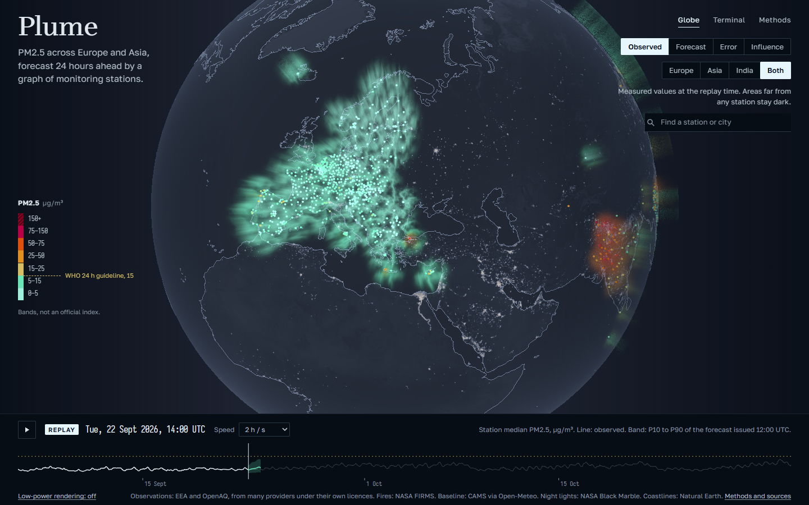
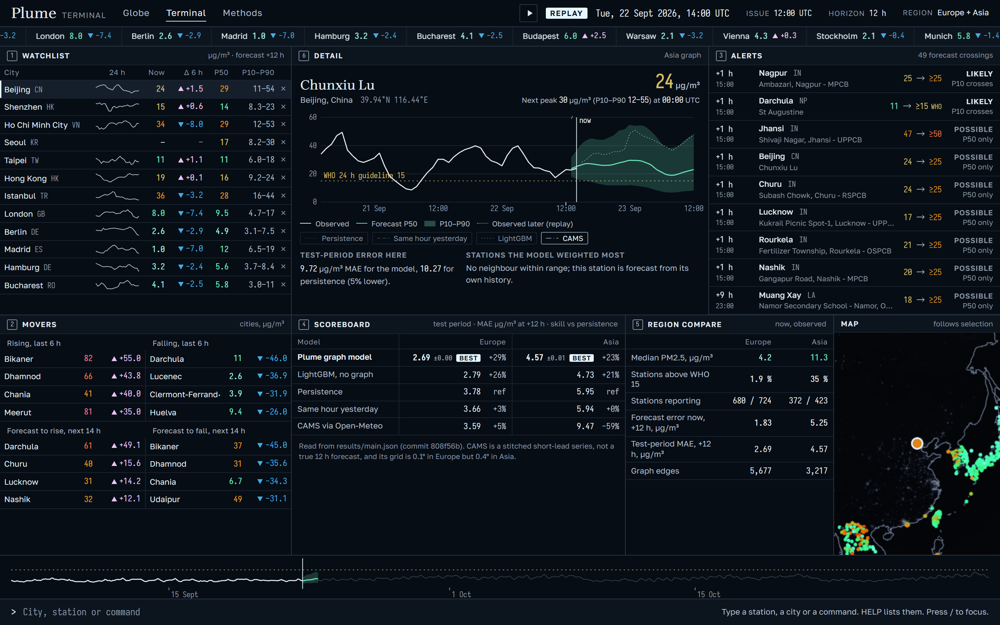

# Plume

PM2.5 across Europe and Asia, forecast 24 hours ahead by a graph of monitoring stations.

Air-quality stations are nodes. Edges join neighbours and carry how strongly the wind blows from one to the
other. A small spatiotemporal graph network forecasts hourly PM2.5 for the next 24 hours at every station,
with a P10 to P90 range. The same forecasts are shown two ways:

- **Globe**: a 3D Earth with an atmosphere that glows faint green where the air is clean and thickens into
  amber and ember haze where it is not.
- **Terminal**: a dense, keyboard-first layout that treats cities like tickers, with a scoreboard of the
  model against its baselines.

A **Methods** page reports how good the model is, region by region, including where it loses.

The app is a **replay of a held-out test period** (September and October 2026), not a live service.





## Results

Every number here is written by `ml/tools/report_tables.py` from `results/*.json`. All models are scored on
the same forecasts: every hourly origin in August to October 2026, every station that reported in the
previous 48 hours, every horizon whose target hour was really measured. The graph model's rows are the mean
and standard deviation of three seeds. Bold marks the lowest error in a column.

**Headline, stated plainly.** The graph model is the most accurate of the five models on mean absolute
error over all 24 horizons in both regions, but its margin over LightGBM, which sees no neighbours, is small:
3.2% in Europe and 2.4% in Asia. It ties LightGBM at 1 h. Wind-aware edges add almost nothing over
distance-only edges. For stations it has never seen, it beats interpolation in Asia and loses to it in
Europe. The test period has no winter. Details and caveats are in [REPORT.md](REPORT.md).

<!-- results:main:start -->
**Europe** (MAE, µg/m³, test period; chosen model: shared)

| Model | 1 h | 3 h | 6 h | 12 h | 24 h | Skill vs persistence at 24 h |
|---|---:|---:|---:|---:|---:|---:|
| Plume graph model | 1.04 ±0.00 | **1.71 ±0.00** | **2.15 ±0.01** | **2.52 ±0.01** | **2.81 ±0.01** | +17.9% |
| LightGBM (no graph) | **1.04** | 1.78 | 2.27 | 2.60 | 2.83 | +17.6% |
| Persistence | 1.11 | 2.10 | 2.87 | 3.41 | 3.43 | reference |
| Seasonal naive | 3.31 | 3.36 | 3.40 | 3.42 | 3.43 | +0.0% |
| CAMS via Open-Meteo | 3.29 | 3.29 | 3.29 | 3.29 | 3.29 | +4.1% |

**Asia** (MAE, µg/m³, test period; chosen model: shared)

| Model | 1 h | 3 h | 6 h | 12 h | 24 h | Skill vs persistence at 24 h |
|---|---:|---:|---:|---:|---:|---:|
| Plume graph model | **2.47 ±0.00** | **3.61 ±0.02** | **4.20 ±0.02** | **4.66 ±0.02** | **5.09 ±0.00** | +14.7% |
| LightGBM (no graph) | 2.49 | 3.73 | 4.33 | 4.76 | 5.18 | +13.3% |
| Persistence | 2.63 | 4.28 | 5.36 | 5.95 | 5.98 | reference |
| Seasonal naive | 5.76 | 5.85 | 5.91 | 5.94 | 5.98 | +0.0% |
| CAMS via Open-Meteo | 9.47 | 9.47 | 9.47 | 9.47 | 9.46 | -58.4% |

<!-- results:main:end -->

How to read this:

- **CAMS is not a fair 24-hour comparison.** The series Open-Meteo stores is stitched from recent forecast
  runs, so each value was made a few hours ahead. Its row is flat across horizons for that reason. Europe
  uses CAMS Europe (0.1°); Asia uses CAMS global (0.4°, 3-hourly, interpolated to hourly by Open-Meteo).
  Skill against CAMS in the two regions is not like for like.
- **The honest test of the graph is the LightGBM row**: same inputs, no neighbours.
- The test period has no winter in it. See limitations in [REPORT.md](REPORT.md).

### Does the wind-aware graph help?

<!-- results:ablation:start -->
| Region | Variant | Seeds | Mean MAE over 24 horizons | 1 h | 6 h | 24 h | vs no graph |
|---|---|---:|---:|---:|---:|---:|---:|
| Europe (median edge 65 km) | No graph | 3 | 2.503 ±0.009 | 1.08 ±0.00 | 2.34 ±0.01 | 2.90 ±0.01 | reference |
| Europe (median edge 65 km) | Distance-only edges | 3 | 2.399 ±0.001 | 1.05 ±0.00 | 2.19 ±0.00 | 2.81 ±0.00 | -4.16% |
| Europe (median edge 65 km) | Wind-aware edges | 3 | 2.393 ±0.001 | 1.04 ±0.00 | 2.18 ±0.01 | 2.81 ±0.00 | -4.41% |
| Asia (median edge 82 km) | No graph | 3 | 4.643 ±0.011 | 2.53 ±0.01 | 4.39 ±0.02 | 5.23 ±0.00 | reference |
| Asia (median edge 82 km) | Distance-only edges | 3 | 4.508 ±0.008 | 2.47 ±0.00 | 4.23 ±0.01 | 5.10 ±0.01 | -2.92% |
| Asia (median edge 82 km) | Wind-aware edges | 3 | 4.502 ±0.004 | 2.47 ±0.00 | 4.22 ±0.02 | 5.10 ±0.00 | -3.05% |
<!-- results:ablation:end -->

The interpretation, with its caveats, is in [REPORT.md](REPORT.md#ablation-does-the-wind-aware-graph-help).

### Calibration (share of measurements inside P10 to P90; target 80%)

<!-- results:calibration:start -->
| Region | 1 h | 3 h | 6 h | 12 h | 24 h | Mean over 24 h | Below P10 | Above P90 |
|---|---:|---:|---:|---:|---:|---:|---:|---:|
| Europe | 82.9% | 81.5% | 80.7% | 80.9% | 81.2% | 81.0% | 10.6% | 8.4% |
| Asia | 78.9% | 79.5% | 80.1% | 80.7% | 81.0% | 80.4% | 10.4% | 9.2% |
<!-- results:calibration:end -->

## Run it

Requirements: Python 3.11+, Node 20+, about 30 GB of free disk for the data stage. No GPU, no API keys.

```bash
make setup     # Python venv and web dependencies
make data      # download OpenAQ, ERA5 and CAMS extracts; clean; choose stations (about 1 h, network-bound)
make train     # baselines and all graph-model runs (about 2.5 h on 4 CPU cores; safe to re-run after an interruption)
make eval      # re-score everything, rewrite results/*.json, re-export the app data, verify it, refresh the tables
make web       # dev server on http://localhost:5173
make build     # static site in web/dist
```

`make eval` is the one command that reproduces every number in the app and in this file from saved
predictions. `make check` reloads the shipped binary files and confirms they reproduce
`results/replay_check.json`.

The app data in `web/public/data/` (about 44 MB) is committed, so `make setup && make web` shows the app
without running the pipeline.

## Layout

```
ml/plume_data/   discovery, download, cleaning, station selection, ERA5/CAMS extraction
ml/plume/        tensors and graphs, baselines, model, training, evaluation, export
ml/tools/       colour-vision and contrast checks, table rendering
qa/             screenshot, command-bar and frame-rate scripts (Playwright; need `make web` running)
results/        every metric as JSON, each with the script and commit that wrote it
web/            Vite + React + TypeScript + three.js app
docs/           screenshots, font test shots
```

## Data and attribution

- **Observations:** [OpenAQ](https://openaq.org), open-data archive on AWS. OpenAQ aggregates measurements
  from many government and research providers, each under its own licence; check the provider's terms before
  reusing station data.
- **CAMS PM2.5 baseline and ERA5 weather:** Copernicus Atmosphere Monitoring Service and Copernicus Climate
  Change Service, through [Open-Meteo](https://open-meteo.com)'s open-data distribution (CC BY 4.0).
  Contains modified Copernicus information.
- **Night lights:** NASA Black Marble 2016 via NASA GIBS (public domain).
- **Coastlines and country polygons:** Natural Earth (public domain). **City names:** GeoNames (CC BY 4.0).
- **Fonts:** Brygada 1918, Golos Text, Iosevka, all SIL Open Font License, self-hosted through Fontsource.

## More

- [REPORT.md](REPORT.md): data quality and coverage, every experiment, failures, limitations.
- [DECISIONS.md](DECISIONS.md): judgement calls made during the build, including the font test.
